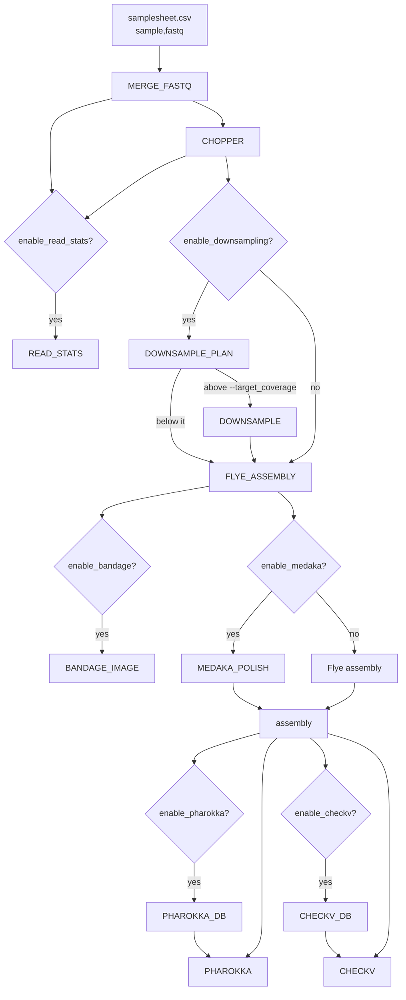

# ulana-phage-nf

Phage genome assembly and annotation from Oxford Nanopore long reads, in
Nextflow (DSL2). Built from [ulana-nf](https://github.com/ehill-iolani/ulana-nf)'s
skeleton: the same read handling, depth capping, Flye assembly and Medaka
polishing, with the bacterial steps (Prokka, CheckM, identifier genes,
AMRFinder, GenBank) replaced by [Pharokka](https://github.com/gbouras13/pharokka)
annotation and [CheckV](https://bitbucket.org/berkeleylab/checkv) completeness.

## What it does

1. `MERGE_FASTQ` -- merge multi-part fastq(.gz) files per sample
2. `CHOPPER` -- quality + length filtering
   - `READ_STATS` (side branch, `--enable_read_stats`, on by default) -- read length and mean Q-score before vs. after filtering
   - `DOWNSAMPLE_PLAN` + `DOWNSAMPLE` -- cap very deep samples at `--target_coverage` before assembly (on by default, see [Downsampling](#downsampling))
3. `FLYE_ASSEMBLY` -- assembly; a contig holding two copies of the genome is cut to one (see [One copy per genome](#one-copy-per-genome))
4. `BANDAGE_IMAGE` -- render a PNG of the Flye assembly graph (optional, default on)
5. `MEDAKA_POLISH` -- polish (optional, default on)
6. `PHAROKKA_DB` + `PHAROKKA` -- annotate (optional, default on)
7. `CHECKV_DB` + `CHECKV` -- completeness and host contamination (optional, default on)



## Requirements

- [Nextflow](https://www.nextflow.io/) >= 23.10.0
- Docker or Singularity (every process is containerized)
- About 9 GB of disk for the Pharokka and CheckV databases, fetched on the
  first run and cached in `--db_cache` (see [Databases](#databases))

## Quickstart

```bash
nextflow run main.nf --input samplesheet.csv -profile docker
```

`samplesheet.csv` is a two-column CSV:

```csv
sample,fastq
phage-07,data/barcode07/*.fastq.gz
phage-22,data/barcode22/*.fastq.gz
```

Each row needs its own `sample` name (compared ignoring case): two rows with
the same name stop the run at launch. A damaged `.fastq.gz` part stops the
run at `MERGE_FASTQ` with the sample and file named, rather than silently
losing every read after it.

On an Apple-silicon Mac, Pharokka needs a locally built image, see
[Apple-silicon Macs](#apple-silicon-macs).

## Parameters

See `nextflow_schema.json` for the full list with defaults and validation, or
run `nextflow run main.nf --help`. Key ones:

| Parameter | Default | Description |
|---|---|---|
| `--input` | *(required)* | Samplesheet CSV (`sample,fastq`) |
| `--outdir` | `results` | Output directory |
| `--chopper_q` / `--chopper_minlength` | `10` / `1000` | chopper quality/length filtering |
| `--enable_read_stats` | `true` | Read length/Q-score summary before vs. after filtering |
| `--enable_downsampling` / `--target_coverage` | `true` / `150` | Subsample samples deeper than this to it before assembly (Rasusa) |
| `--genome_size` | *(blank: LRGE estimates it per sample)* | Genome size the target coverage is worked out from, e.g. `40kb`; 1 kb to 1 Mb |
| `--phage_size_min` / `--phage_size_max` | `15000` / `500000` | Range (bp) an LRGE estimate is held to |
| `--flye_mode` | `--nano-hq` | Flye read-type flag |
| `--enable_bandage` / `--bandage_height` | `true` / `1000` | Render a PNG of the Flye assembly graph |
| `--enable_medaka` / `--medaka_model` | `true` / `r1041_e82_400bps_hac_v5.0.0` | Medaka polishing |
| `--enable_pharokka` | `true` | Pharokka annotation |
| `--enable_checkv` | `true` | CheckV completeness and contamination |
| `--db_cache` | `assets/db_cache` | Where the databases are cached (`gs://nextflow-jobs/phage/db_cache` on Batch) |
| `--pharokka_container` | *(the biocontainer)* | Pharokka image to use instead, for Apple-silicon Macs |
| `--container_registry` / `--dockerhub_registry` | `quay.io` / `docker.io` | Registries the tool images are pulled from. The `google_batch` profile points both at the project's Artifact Registry mirror (see [Container mirror](#container-mirror)) |

## Output layout

```
results/
  {sample}/
    reads/                 merged + filtered fastq, {sample}.downsampling.tsv (only if --enable_downsampling)
    assembly/flye/         assembly.fasta, assembly_info.txt, assembly_graph.gfa, flye_reads.tsv, copies.tsv, assembly_graph.png (only if --enable_bandage)
    polish/medaka/         polished_consensus.fasta (only if --enable_medaka)
    annotation/pharokka/   pharokka.gff/.gbk/.tbl, pharokka_cds_final_merged_output.tsv, pharokka_cds_functions.tsv,
                           pharokka_top_hits_mash_inphared.tsv, top_hits_card.tsv, top_hits_vfdb.tsv,
                           phanotate.faa/.ffn (only if --enable_pharokka)
    qc/checkv/             quality_summary.tsv, completeness.tsv, contamination.tsv, complete_genomes.tsv (only if --enable_checkv)
  read_qc/                 read_qc_summary.html, read_stats.tsv, read_length_qscore_hist.tsv (only if --enable_read_stats)
  pipeline_info/           Nextflow timeline/report/trace
```

## Repo structure

```
main.nf                       entry point, samplesheet parsing, --help
workflows/ulana_phage.nf      subworkflow chaining all steps
modules/*.nf                  one process per tool, one container each
bin/read_stats.py             read length/Q-score summary (stdlib only; also runs stand-alone)
bin/collapse_copies.py        cuts a contig made of back-to-back genome copies to one copy (stdlib only)
bin/pharokka_names.py         renames contigs around Pharokka so two genes can't get the same name (stdlib only)
nextflow.config               param defaults, profiles, resource labels
nextflow_schema.json          JSON Schema describing every --param (for UIs/validation tooling)
conf/test.config              -profile test overrides (small public T7 dataset)
tests/data/                   the T7 reads used by -profile test; stub/ = their real Pharokka/CheckV outputs, for -stub-run
docker/pharokka-compat/       local-only Pharokka image for Apple-silicon Macs
scripts/mirror_images.sh      copies the pipeline's container images into our Artifact Registry (see Container mirror)
.github/workflows/ci.yml      runs -profile test on push/PR
```

`merge_fastq`, `chopper`, `read_stats`, `bandage_image` and `medaka` are
copies of ulana-nf's modules; `downsample` is too, apart from the genome-size
limit below, and `flye` apart from its second try and its one-copy check. Keep fixes in step between
the two repos.

## Downsampling

Flye fails on very deep data: a ~91 kb phage sequenced to ~5,000x stopped
with "No disjointigs were assembled", while a 1/20 subsample of the same
reads assembled into one contig. Phage isolates are often sequenced that
deep, so before assembly each sample's filtered reads are capped at
`--target_coverage` (default 150x):

1. `DOWNSAMPLE_PLAN` counts the sample's bases and takes the genome size from
   `--genome_size`, or, left blank, estimates it from the reads with
   [LRGE](https://github.com/mbhall88/lrge). The estimate is held to
   `--phage_size_min`..`--phage_size_max` (15-500 kb, the range of nearly
   every tailed phage): LRGE guesses high on phages (131 kb for 40 kb T7,
   82-109 kb for ~90 kb phages), which errs towards keeping more reads, but an
   estimate far outside the range would either skip downsampling or cut too
   deep. If LRGE fails, the upper bound is used, so a shallow sample keeps
   every read and a deep one is still capped.
2. A sample with more than `target_coverage x genome size` bases goes to
   `DOWNSAMPLE`, where [Rasusa](https://github.com/mbhall88/rasusa) keeps a
   random subset of about that many bases (seeded, so a rerun picks the same
   reads).
3. Any other sample keeps every filtered read.

Flye and Medaka both use the subsampled reads, so Flye's `assembly_info.txt`
coverage is the depth of the reads used. `reads/{sample}.downsampling.tsv`
records the decision:

| Column | Meaning |
|---|---|
| `read_bases`, `read_coverage` | bases after chopper, and that depth |
| `genome_size`, `genome_size_source` | bp used, and `given` / `estimated` / `estimate_raised` / `estimate_lowered` / `no_estimate` |
| `target_coverage` | `--target_coverage` |
| `reads_used` | `subsample` or `all` |
| `assembly_bases`, `assembly_coverage` | what went to Flye (the target, for a subsample) |
| `lrge_estimate` | LRGE's own estimate before the limit (blank when `--genome_size` was given or LRGE failed) |

### Second Flye try when the size estimate is wrong

The cap is only as good as the genome size. A whole-plaque WGS prep carries
host DNA, so LRGE sizes the host rather than the phage and nothing is cut:
one such sample was estimated at 3.7 Mb, held to 500 kb, kept all 46 Mb of
reads, and Flye failed at 583x. Flye measures the depth itself before it
gives up ("Overlap-based coverage"), so when it fails with "No disjointigs
were assembled" at more than `--target_coverage`, `FLYE_ASSEMBLY` takes a
seeded random `target / measured` share of the reads (150/583 = 26% there)
and runs Flye once more. Any other Flye error, or a second failure, still
fails the sample. Off with `--enable_downsampling false`. Medaka still
polishes with every read Flye was given at first.
`assembly/flye/flye_reads.tsv` records it:

| Column | Meaning |
|---|---|
| `reads_used` | `all`, or `subset` after a second try |
| `subset_fraction` | share of the reads assembled on the second try (`1` otherwise) |
| `first_try_coverage` | Flye's overlap-based coverage on the reads it was given |
| `assembled_coverage` | the same on the reads it assembled |

The first nine columns are the same as ulana-nf's.

### One copy per genome

Flye sometimes reports a phage as a single contig holding two back-to-back
copies of its genome: three ~43 kb phages in one validation set came out at
~85 kb. The results would then show a phage twice its size with every gene
twice, and Medaka polishes such a contig badly, since each read fits either
copy. `FLYE_ASSEMBLY` runs `bin/collapse_copies.py` on Flye's contigs and cuts
such a contig to one copy before Medaka, CheckV and Pharokka see it.

A contig is cut only when at least 80% of the k-mers that could recur one
copy-length later do, and the repeat spans at least 90% of a copy. A phage's
terminal repeat (a few hundred bp at both ends) is far shorter and is left
alone. The cut is where the contig's start comes round again, so the kept copy
joins up end to start. Contigs over 2 x `--phage_size_max` (host DNA) aren't
checked. `assembly_info.txt` and the graph stay as Flye made them;
`assembly/flye/copies.tsv` lists what was cut (only its header when nothing
was):

| Column | Meaning |
|---|---|
| `contig` | Flye's contig name, kept on the cut contig |
| `flye_length`, `copy_length` | bp before and after |
| `copies` | `flye_length / copy_length` (e.g. `2.00`) |
| `shared_kmers` | share of the k-mers that recur one copy later |

## Annotation and QC

**Pharokka** switches to meta mode (`-m`) when the assembly has more than
one contig, so that each contig gets its own closest-phage hit and stats; an
isolate's assembly can hold a host fragment as well as the phage. (Pharokka
refuses `-m` on a single contig.) Meta mode would switch the gene caller to
prodigal-gv and skip the HMM search, so `-g phanotate` (always) and
`--meta_hmm` keep the isolate defaults. Contigs keep Flye's start position (no dnaapler reorientation).
Pharokka 1.10.1 names its working proteins contig name + gene number with
nothing between, counting genes across the whole assembly, so on a
many-contig assembly two genes can get the same name (gene 825 on contig_8
and gene 25 on contig_88 are both `contig_8825`) and it stops with
"Duplicate key". `bin/pharokka_names.py` hands Pharokka names ending in a
letter (`contig_8x`) and takes the letter back off in every output, so the
published files use the assembly's own contig names.
A novel phage often has no INPHARED hit within Mash distance 0.2;
`pharokka_top_hits_mash_inphared.tsv` then says `no_inphared_mash_hit`, which
is a normal result.

**CheckV** labels every contig (none are dropped) with a quality tier,
completeness and viral vs. host gene counts. Flye reports a terminally
redundant linear phage such as T7 as "circular" because its ends overlap;
CheckV's `complete_genomes.tsv` only lists contigs whose terminal repeat it
can see, so it's usually empty for Flye assemblies even when completeness is
~100%.

## Databases

`PHAROKKA_DB` (Pharokka's v1.8.0 databases: PHROGs, CARD, VFDB, INPHARED
Mash sketch; 656 MB download, 1.8 GB unpacked) and `CHECKV_DB` (CheckV v1.5;
1.7 GB download, 6.4 GB with its DIAMOND index) download into `--db_cache`
through `storeDir`, so each is fetched once per location and reused after
that. Both are pinned: a database release only changes when the module
changes. On Google Batch the cache is `gs://nextflow-jobs/phage/db_cache`.

## Apple-silicon Macs

The Pharokka biocontainer segfaults under Docker's amd64 emulation (its
polars runtime needs AVX2, which the emulator lacks). Build the local fix
once and point the run at it:

```bash
docker build --platform linux/amd64 -t pharokka-local:1.10.1 docker/pharokka-compat
nextflow run main.nf -profile test,docker --pharokka_container pharokka-local:1.10.1
```

Real x86 machines (Google Batch, CI) use the stock image.

## Container mirror

On Google Batch every task starts on a fresh VM and pulls its image, so the
`google_batch` profile pulls from our own Artifact Registry repo
(`us-central1-docker.pkg.dev/iscc-400300/containers`, shared with the other
pipelines), which keeps each image's upstream path so only the registry host
differs. `scripts/mirror_images.sh` fills it from the pipeline's own
`container` directives:

```bash
gcloud auth configure-docker us-central1-docker.pkg.dev   # once, for pushing
scripts/mirror_images.sh --check     # read-only: is every image there, same digest as upstream?
scripts/mirror_images.sh             # copy whatever is missing
```

Run it whenever an image tag is added or changed, and before releasing.

## Testing

```bash
nextflow run main.nf -profile test,docker
```

Runs against the first 1,113 reads (2.5 Mb, ~35x) of a public T7 MinION run,
SRA [SRR30401542](https://www.ncbi.nlm.nih.gov/sra/SRR30401542) (BioProject
PRJNA607328, Escherichia phage T7 FELIX_MS570), checked into `tests/data/`.
Every step is on, so the first run downloads both databases. Expected: one
~38.6 kb contig, closest INPHARED phage T7 (NC_001604), CheckV high quality.

CI runs the same profile with `-stub-run`, to avoid the 8.2 GB of databases:

```bash
nextflow run main.nf -profile test,docker -stub-run
```

Pharokka and CheckV then skip their database steps and copy in this
dataset's real outputs from `tests/data/stub/` (whatever the assembly);
every other step runs for real. Both tools are pinned by container tag, so
run the full test locally whenever either tag changes, and refresh
`tests/data/stub/` from its `results/t7/` if their outputs change.

## Citation

Based on the ULANA pipeline concept (Unicellular Long-read Assembly aNd
Annotation). See the [ULANA paper](https://www.liebertpub.com/doi/10.1089/ast.2023.0072):

Prescott, R. D., Chan, Y. L., Tong, E. J., Bunn, F., Onouye, C. T., Handel, C., Lo, C.-C., Davenport, K., Johnson, S., Flynn, M., Saito, J. A., Lee, H., Wong, K., Lawson, B. N., Hiura, K., Sager, K., Sadones, M., Hill, E. C., Esibill, D., … Donachie, S. P. (2023a). Bridging Place-based astrobiology education with genomics, including descriptions of three novel bacterial species isolated from Mars analog sites of cultural relevance. Astrobiology, 23(12), 1348–1367. https://doi.org/10.1089/ast.2023.0072

Tools: Flye, Medaka, Rasusa, LRGE, chopper, Bandage, Pharokka (Bouras et al.
2023, Bioinformatics 39:btac776), PHANOTATE, PHROGs, INPHARED, CheckV
(Nayfach et al. 2021, Nat Biotechnol 39:578-585).
